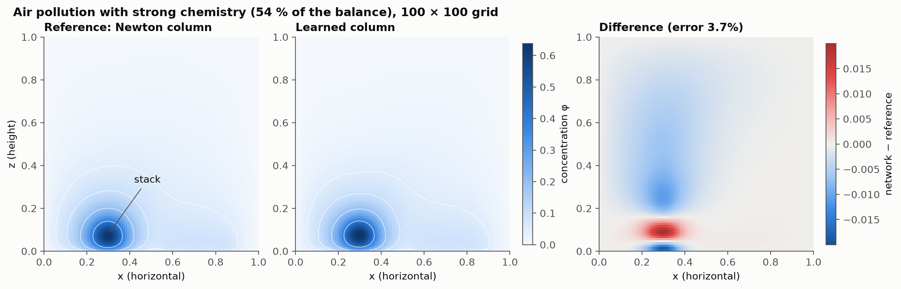
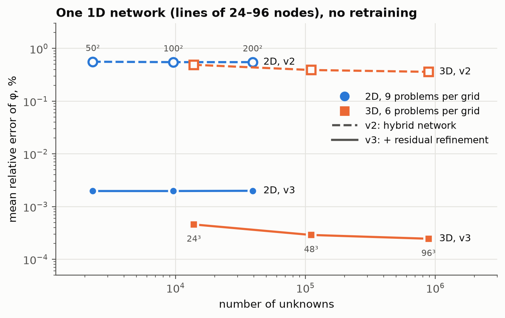
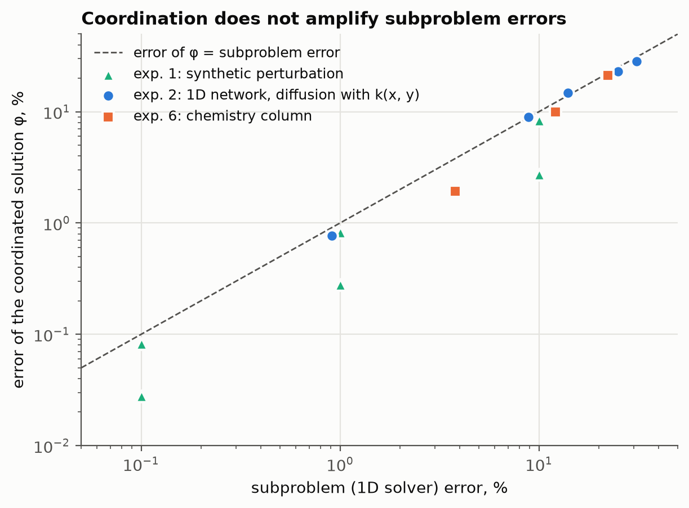
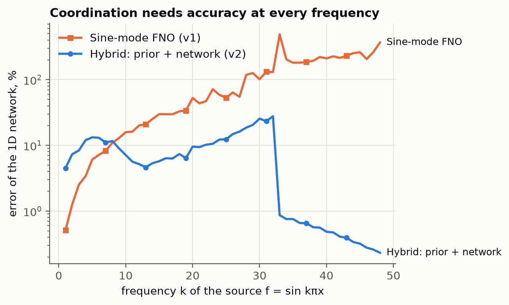

# Coordinating learned 1D solvers

**One small neural network trained only on 1D lines solves 2D and 3D diffusion problems, with no 2D or 3D training data.**

A multidimensional elliptic problem is split by coordinate direction into batches of independent
1D problems (all x-lines, all y-lines, …). An unknown *coordinator* field `q` couples them and is
chosen so that all directions agree. The method only ever **solves** 1D subproblems, so any 1D
solver can be plugged in, including a neural network or another black box.

The coordination method comes from earlier unpublished diploma work on solving 2D problems
through coordinated 1D subproblems. This project builds on it: the 1D solvers are replaced by neural networks,
and the method is extended to 3D and to nonlinear chemistry columns.



## Key results (laptop CPU, PyTorch)

| | result |
|---|---|
| Error amplification | Error of the assembled solution ≤ error of the 1D solver (ratio 0.3–1.05), independent of grid size |
| 2D, variable k(x, y) | **0.55 %** mean error on 50², 100², 200² grids (v2); **0.002 %** with residual refinement (v3); 17–23 GMRES iterations |
| 3D | **0.36–0.49 %** on 24³ … 96³ grids (up to 885 k unknowns), same network, no retraining; **0.0002–0.0005 %** with v3 |
| Training | ≈ 4 min on CPU, 1D data only (free: generated with the Thomas algorithm) |
| vs. 2D FNO trained on 2D data | **0.05–0.7 %** vs 3.5–9.9 % mean error on every grid and boundary type (with residual refinement, `nn_line_refined.py`); FNO is 40–60× faster at inference |
| Nonlinear chemistry column | 0.1–3.9 % error depending on chemistry strength; only the vertical column is learned |
| 3 reacting species (NO–NO₂–O₃) | network as a warm start for Newton: machine precision after 3 steps, columns 1.9–3.2× faster; no end-to-end gain in the steady problem (coupling dominates) |

<p>


</p>

## How it works

```
X u = b_x − q        (all x-lines, independent 1D solves)
Y v = b_y + q        (all y-lines, independent 1D solves)
R(q) = u − v = 0     → solved by GMRES / Newton–Krylov
```

If `u = v`, then `(X + Y) u = b`: the coordinated state is the solution of the 2D problem.
In 3D there are two coordinators and three line families.

**The 1D network** (`LineHybrid` in `nn_coordination_grids.py`) is an analytic prior plus a learned
correction of the 32 lowest sine modes: `w = P₀(c) f + Sᵀ G_θ(c) S f`. It is exactly linear in the
source `f`, works for any line length, and is trained with a residual-norm loss.

**Lesson learned:** a standard 1D Fourier neural operator with 0.3 % L² error failed inside the loop
(7–415 % error), because its error at high frequencies was 100–400 %. A subproblem surrogate has to be
accurate across *all* frequencies.



## Honest limitations

- With an exact 1D solver available, the method is **not faster** than ADI-preconditioned GMRES on the
  original problem. We show they are spectrally equivalent. The value is modularity: the 1D model may be
  learned, expensive, or unavailable in closed form.
- The learned-column solve is currently slower end to end than the exact one (Python Newton–Krylov overhead).
- Strong single-species chemistry still gives ≈ 3.8 % error. With three species the answer is exact, but in the steady
  problem the faster column solves do not shorten the whole run (coupling iterations dominate).
- The 1D network degrades for coefficient contrast above ≈ 50 along a single line (one 13 % outlier in the
  FNO comparison); against the 2D FNO, inference is 40–60× slower.

## Reproduce

```bash
python -m venv .venv && .venv/bin/pip install -r requirements.txt
.venv/bin/python surrogate_error_robustness.py   # exp 1: synthetic error amplification
.venv/bin/python nn_coordination_grids.py        # exp 4: 1D network on 2D grids
.venv/bin/python nn_line_refined.py              # 1D network v3, trained through residual refinement
.venv/bin/python nn_coordination_3d.py           # exp 5: same network in 3D
.venv/bin/python nn_column_chemistry.py          # exp 6: learned chemistry column
.venv/bin/python nn_column_multispecies.py       # exp 7: 3 species, learned warm start for Newton
.venv/bin/python baseline_fno2d.py               # comparison with a 2D FNO
.venv/bin/python make_figures.py                 # figures in results/figures/
```

Logs of every run are in `results/*.log`. A paper draft is in `paper/` (LaTeX, compiles on Overleaf).

## Repository layout

| path | what it is |
|---|---|
| `nn_*.py`, `surrogate_error_robustness.py`, `baseline_fno2d.py` | the experiments of the paper (see *Reproduce*) |
| `coordinator_laplace_descent.py`, `batched_tridiagonal.py` | core: the coordination solver and batched Thomas / PCR line solvers |
| `adi_direct_vs_coordination.py` | control experiment: coordination vs. ADI-preconditioned GMRES |
| `plate_coordination.py`, `multi_coordination.py` | the original diploma problem (heat plate) and the general K-subsystem method |
| `eco_pollution.py`, `eco_inverse.py` | air-pollution model solved by coordination, and finding sources from station data |
| `laplace_gpu_benchmark.py`, `RUN_NVIDIA.md` | GPU benchmark (Apple MPS / NVIDIA CUDA) |
| `checks/` | correctness tests of the solvers (`python checks/run_checks.py`) |
| `results/` | logs of every run, trained weights, figures; `results/*_data.pt` training sets are regenerated by the scripts |
| `paper/` | LaTeX draft (`main.tex`, `refs.bib`) |

Code comments and log messages are in Russian; the paper and this README are in English.

## Related work

Neural solvers inside Schwarz domain decomposition (L-DDM, FEM + DeepONet), neural preconditioners,
neural operator splitting (DOSnet), learned column physics in climate models (NeuralGCM, ClimSim).
We did not find prior work that couples learned **1D line solvers** through a coordinator field.

## License

MIT, see [LICENSE](LICENSE). Author: Artemii-Denys Vitiuk.
